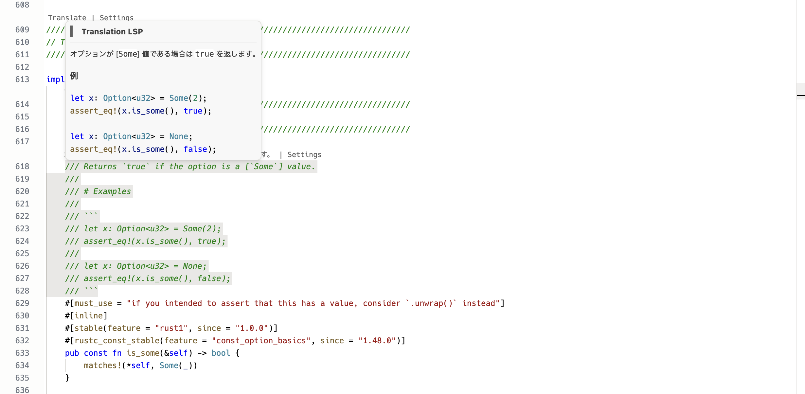
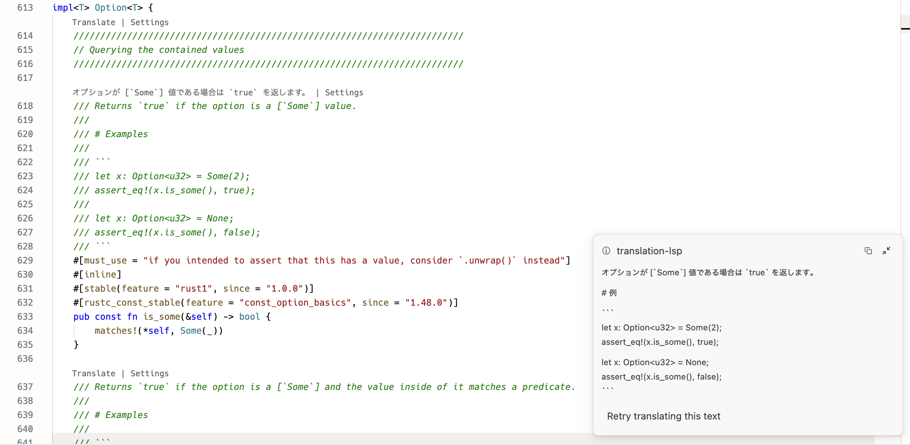
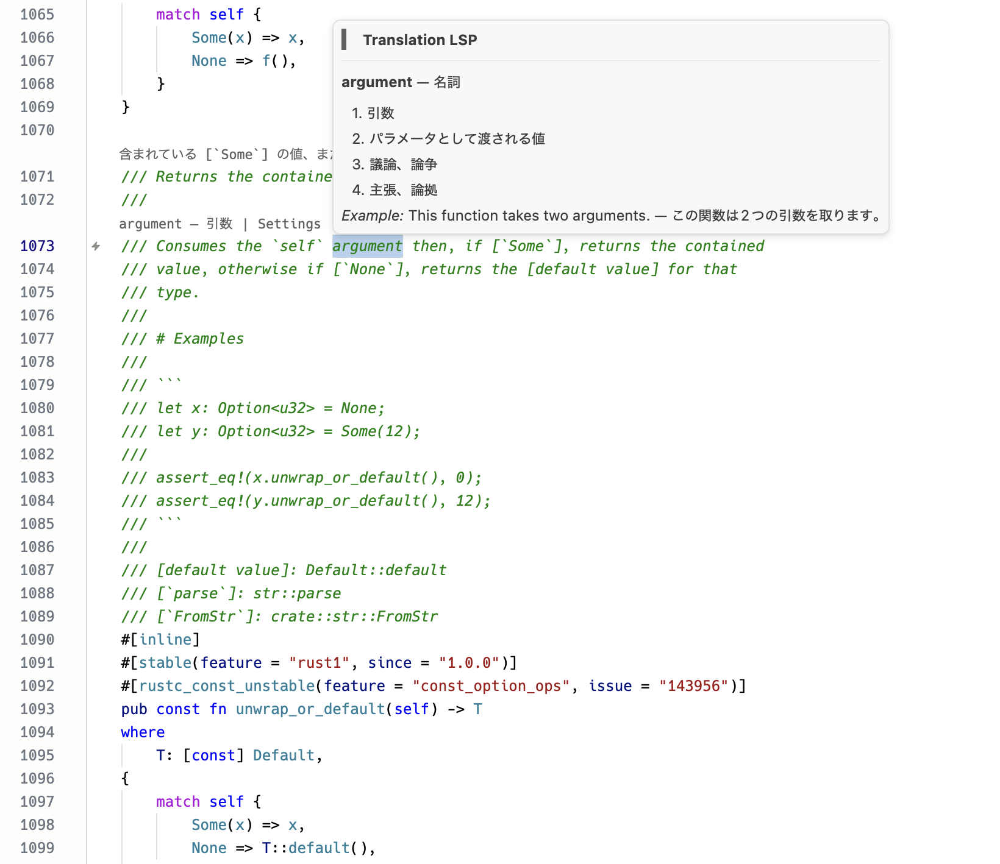

# Translation LSP

[English](README.md)

Translation LSPは、Zedでコードのコメントと、Markdownの文章を翻訳し、ホバー表示（テキスト上で開く情報表示）に訳文を出します。原文は変わりません。Rust、TypeScript、Python、Go、シェルスクリプトなど、40の言語と形式のコメントを読めます。言語の一覧は[対応言語](docs/ja/languages.md)にあります。

翻訳には、ChatGPT（本人のプラン）、Anthropic API、OpenAI API、OllamaなどのOpenAI互換のサービスを使えます。翻訳サービスのDeepL APIとGoogle Cloud Translationも使えます。プロバイダーを選ぶまでは、文章を外部へ送りません。

- **ホバー:** コメントにマウスポインターを重ねると、訳文を読めます。

  

- **Markdownの選択:** Markdownの文章を選択するとバックグラウンドで翻訳し、その範囲のホバーで訳文を読めます。

- **CodeLens:** CodeLensを有効にすると、訳文の1行目がコメントの上に出ます。クリックすると全体を読めます。

  

- **単語の意味:** 単語を選択すると、その語の意味と用例をモデルに尋ねて表示します。

  

## 導入

Translation LSPは、開発用拡張として導入します。Zedがチェックアウトから拡張をビルドし、拡張が言語サーバーを取得します。

1. Zedと、[rustup経由のRust](https://www.rust-lang.org/tools/install)を導入します。Zedは、開発用拡張のビルドにRustを使います。
2. このリポジトリをクローンし、[公開済みリリース](https://github.com/hwtnb/zed-translation-lsp/releases)のタグをチェックアウトします。
3. Zedの拡張画面で `Install Dev Extension` を選び、チェックアウト内の **`crates/zed-extension`** を指定します。[Zedの開発用拡張の導入手順](https://zed.dev/docs/extensions/developing-extensions)も参照してください。

Zedの設定で言語の言語サーバーを列挙している場合は、その一覧に `"translation-lsp"` を加えてください。[言語サーバーの設定](docs/ja/languages.md#言語サーバーの設定)を参照してください。

言語サーバーを最初に起動するとき、拡張は自分と同じバージョンのサーバーをそのリリースから取得し、以後の起動では保存したサーバーを使います。リリースのないバージョンのチェックアウトでは、取得できるサーバーがありません。サーバーを配布している環境は次のとおりです。

| OS | バージョン | CPU |
| --- | --- | --- |
| macOS | macOS 12以降 | AppleシリコンとIntel |
| Linux | Ubuntu 22.04以降、Debian 12以降、そのほかglibc 2.35以降のディストリビューション | ARM64とx86-64 |
| Windows | x86-64はWindows 10以降、ARM64はWindows 11 | ARM64とx86-64 |

サーバーは、Authenticodeの署名もAppleの公証も受けていません。取得したサーバーをOSが起動しない場合や、お使いの環境向けのサーバーが配布されていない場合は、サーバーをソースからビルドしてください。

### サーバーをソースからビルドする

[rustup経由のRust](https://www.rust-lang.org/tools/install)（1.98以降）と、ネイティブ依存のビルドに使うC/C++の開発環境を導入します。

| OS | ビルドの前提 | ネイティブ実行ファイル |
| --- | --- | --- |
| Windows | MSVC版Rust、Visual Studio Build Toolsの「C++によるデスクトップ開発」とWindows SDK。x86-64ではNASM、ARM64ではclang-clも導入し、Visual Studioの開発者用PowerShellまたはコマンドプロンプトを使います。 | `target/release/translation-lsp.exe` |
| macOS | Xcode Command Line Tools（`xcode-select --install`）。 | `target/release/translation-lsp` |
| Linux | GCCまたはClangとC/C++開発ツール。Debian/Ubuntuでは `build-essential` と `ca-certificates` を導入します。 | `target/release/translation-lsp` |

Tree-sitterとTLSプロバイダーはネイティブコードをビルドします。別のツールチェーン構成はTLSプロバイダーの[Windows向け要件](https://aws.github.io/aws-lc-rs/requirements/windows.html)と[Linux向け要件](https://aws.github.io/aws-lc-rs/requirements/linux.html)を参照してください。

リポジトリのルートで次のコマンドを実行します。PowerShell・コマンドプロンプト・Bash・Zshで共通です。

```sh
cargo build -p translation-lsp --release --locked
```

ビルドした実行ファイルの絶対パスを、[サーバーのパス](docs/ja/configuration.md#サーバーのパス)の説明に沿って `lsp.translation-lsp.binary.path` に設定します。拡張はその実行ファイルを起動し、サーバーを取得しません。

## プロバイダーの設定

プロバイダーがないと、言語サーバーは何も翻訳しません。起動したときに、Zedの設定ファイルと英語版READMEのこの節を開くボタンを添えて、プロバイダーを選ぶよう求めます。その後も、対応する文書のコードアクションの `Set up Translation LSP…` から同じボタンを出せます。

既存のZed設定の `lsp` に次のような項目を追加してプロバイダーを選び、言語サーバーを再起動します。この例はChatGPTを選びます。ほかのプロバイダーにするには、`name` を下の表の値に変えます。`target_language` は訳文の言語です。[ほかのよく使う設定](#ほかのよく使う設定)を参照してください。すべての設定は[設定](docs/ja/configuration.md)で説明します。

```json
{
  "lsp": {
    "translation-lsp": {
      "initialization_options": {
        "target_language": "ja",
        "provider": {
          "name": "chatgpt",
          "model": "gpt-6-luna",
          "effort": "low"
        }
      }
    }
  }
}
```

次に、プロバイダーに接続します。対応する文書でZedのコマンドパレットから `editor: toggle code actions` を実行し、表の項目を選びます。キーを保存すると端末のウィンドウが開くので、キーを貼り付けてEnterを押してください。

| プロバイダー | `name` | 接続のしかた | 詳しい説明 |
| --- | --- | --- | --- |
| ChatGPT | `chatgpt` | `ChatGPT account…` から `Continue with ChatGPT / Choose account` を実行し、ブラウザで認証とプラン利用の許可を完了します。 | [ChatGPT](docs/ja/providers/chatgpt.md) |
| Anthropic API | `anthropic_api` | `Anthropic API key…` から `Save Anthropic API key` を実行します。 | [Anthropic API](docs/ja/providers/anthropic.md) |
| OpenAI API | `openai_api` | `OpenAI API key…` から `Save OpenAI API key` を実行します。 | [OpenAI API](docs/ja/providers/openai-api.md) |
| OpenAI互換API | `openai_compatible` | キーが要るサービスでは、`OpenAI-compatible API key…` から `Save OpenAI-compatible API key` を実行します。 | [OpenAI互換API](docs/ja/providers/openai-compatible.md) |
| DeepL API | `deepl` | `DeepL API key…` から `Save DeepL API key` を実行します。 | [DeepL API](docs/ja/providers/deepl.md) |
| Google Cloud Translation | `google_translate` | `Google Cloud API key…` から `Save Google Cloud API key` を実行します。 | [Google Cloud Translation](docs/ja/providers/google-translate.md) |

プロバイダーによって、次の点が違います。

- ChatGPT、Anthropic API、OpenAI APIでは、`model` と `effort` は省略できます。使える値は各プロバイダーのページにあるので、`name` を変えたら、この2つも変えるか消してください。
- OpenAI互換のプロバイダーには、サービスのアドレスの `base_url` と、そのサービスのモデル名の `model` が必要です。[お使いのコンピューターのOllama](docs/ja/providers/openai-compatible.md#お使いのコンピューターのollama)のように、キーの要らないサービスは、キーなしで使えます。
- DeepL APIとGoogle Cloud Translationは、`name` のほかに項目を取りません。`target_language` は言語コードにする必要があり、選択した単語は意味を調べずに翻訳します。

キーの作り方と費用も、各プロバイダーのページで説明します。

### ほかのよく使う設定

次の設定は `initialization_options` の中で `provider` と並べて書きます。どれも省略できます。`provider` と同じく、変えたら言語サーバーを再起動してください。

| 設定 | 既定値 | 内容 |
| --- | --- | --- |
| `target_language` | `ja` | 訳文の言語です。`en`、`ja`、`zh-Hans` のような言語コードか、言語名を書きます。DeepL APIとGoogle Cloud Translationでは言語コードだけを使えます。 |
| `source_language` | `auto` | 原文の言語です。`auto` ではモデルが判別します。 |
| `features.comment_hover` | `true` | コメントへのホバーで翻訳を始めるかどうかです。 |
| `features.automatic_selection` | `true` | Markdownの選択が安定したときにバックグラウンドで翻訳を始めるかどうかです。 |
| `hover.header` | `true` | ホバーで訳文の上に見出しの `Translation LSP` を表示するかどうかです。 |
| `hover.format` | `markdown` | ホバーでの訳文の表示です。`markdown` は訳文が書いた書式を生かし、ほかの文字を書かれたとおりに表示します。`text` はコードブロックの中に表示します。 |

`features` では、翻訳の始め方ごとのオンとオフを言語ごとにも切り替えられます。[翻訳する言語](docs/ja/configuration.md#翻訳する言語)、[機能の切り替え](docs/ja/configuration.md#機能の切り替え)、[ホバーの表示](docs/ja/configuration.md#ホバーの表示)を参照してください。

## 基本的な使い方

| 操作 | 方法 |
| --- | --- |
| コメントのホバー | 対応するコードのコメントにマウスポインターを重ねるか、カーソルを置いてZedの `editor: hover` を実行します。 |
| Markdownの選択 | `features.automatic_selection` が `true` の場合、Markdownの文章を選択して安定させるとバックグラウンドで翻訳します。その範囲でホバーを開いて訳文を読みます。 |
| `Translate selection to …` | このコードアクションは、選択範囲をすぐに翻訳します。バックグラウンド翻訳が失敗したあとにも使えます。終わったら、選択範囲でホバーを開いて訳文を読みます。 |
| 単語の意味を調べる | 1行で3語以下の語句か識別子1つを選択します。ホバーには、モデルが書いた単語の説明が出ます。DeepL APIとGoogle Cloud Translationでは、意味を調べずに翻訳します。 |
| `… and open in tab` | Markdownまたはプレーンテキスト（Zedの言語名は `Plain Text`）では、このコードアクションで選択範囲の訳文を別の文書に開けます。選択がない場合は文書全体を翻訳します。 |
| CodeLens | Zedの設定で `"code_lens": "on"` にすると、コメントに `Translate \| Settings` を、翻訳済みの範囲に訳文の1行目を表示します。クリックすると訳文の全体を読めます。 |
| 取り消し | 範囲にカーソルを置いてコードアクションの `Cancel translation of lines …` を選ぶか、`Cancel all translations` を選びます。 |
| 削除 | 訳文のカードの `Delete translation`、コメントのCodeLensの `Settings` メニュー、Markdownとプレーンテキストのコードアクションを使います。 |

同じプロバイダーと設定で翻訳済みの文章は、別の場所や別の文書にあっても、送り直さずに訳文を表示します。[`disk_cache`](docs/ja/configuration.md#ディスクキャッシュ)を有効にすると、その訳文は再起動のあとも残ります。

これらの操作の規則は[使い方](docs/ja/usage.md)で、キャッシュは[キャッシュ](docs/ja/behavior.md#キャッシュ)で説明します。

## 送信する前に

- コメントの上を通りすぎるだけでも、Zedがホバー要求を送って受け付けられた場合は、翻訳の利用量を消費します。
- コメントに認証情報が書かれていれば、それも一緒に送信されます。
- `features.automatic_selection` が `true` の場合、Markdownの文章は、コピーのために選択しただけでも送信されることがあります。
- 単語の意味を調べると、その語のある行も送信します。
- [`disk_cache`](docs/ja/configuration.md#ディスクキャッシュ)を有効にすると、完了した訳文をこのコンピューターのファイルに書きます。ファイルは暗号化しません。送った文章そのものは書きません。ただし、単語の説明には調べた語と用例が、訳文にはコードや識別子など翻訳しなかった部分が残ります。

1回の要求に含める内容は[送信する内容](docs/ja/usage.md#送信する内容)で説明します。費用は各プロバイダーのページで説明します。

## ドキュメント

- [設定](docs/ja/configuration.md): すべての設定と全体例。サーバーのパスとディスクキャッシュも含みます。
- [ChatGPT](docs/ja/providers/chatgpt.md): 設定と、アカウントへの接続。
- [Anthropic API](docs/ja/providers/anthropic.md): 設定とAPIキー。
- [OpenAI API](docs/ja/providers/openai-api.md): 設定とAPIキー。
- [OpenAI互換API](docs/ja/providers/openai-compatible.md): 設定、いくつかのサービスのアドレス、APIキー。
- [DeepL API](docs/ja/providers/deepl.md): 設定、文章の送り方、APIキー。
- [Google Cloud Translation](docs/ja/providers/google-translate.md): 設定とAPIキー。
- [使い方](docs/ja/usage.md): 翻訳のしかたごとの使い方、取り消しと訳文の削除、送信する内容。
- [動作](docs/ja/behavior.md): 翻訳の処理が始まる、待つ、止まる条件と、訳文のキャッシュ。
- [対応言語](docs/ja/languages.md): 対応する言語、コメントの抽出、言語サーバーの設定。
- [開発](docs/ja/development.md): 検証、モックのプロバイダーとサンプル、CI、依存関係の方針。

## ライセンス

[MIT](LICENSE)です。サーバーの各リリースアーカイブには、サーバーが依存するライブラリのライセンスと、そのソースの取得先が入っています。
